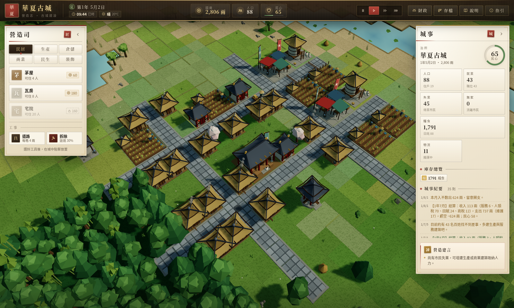
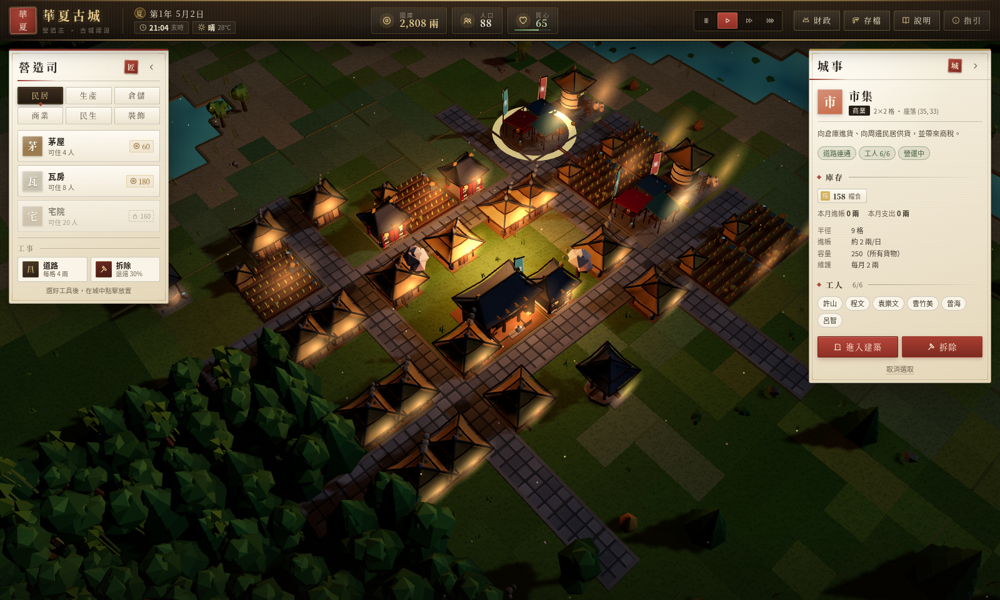
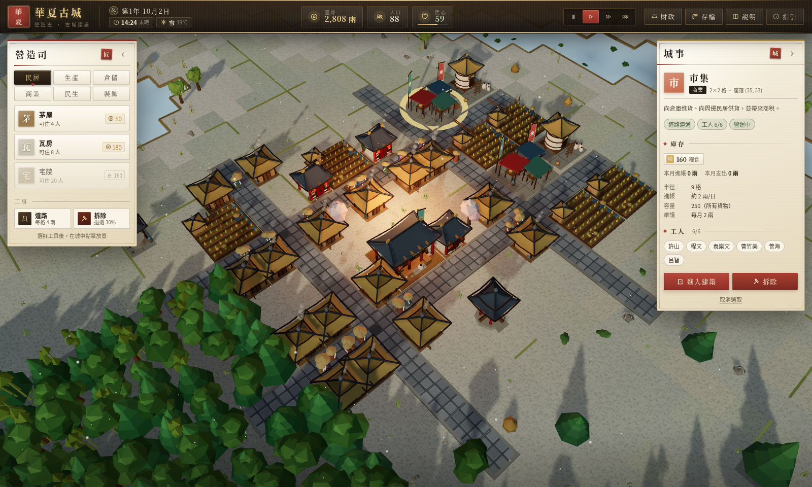
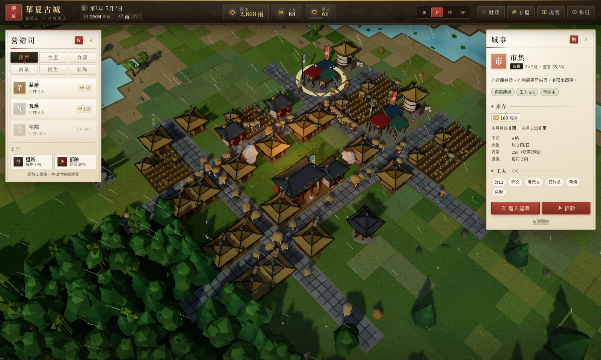
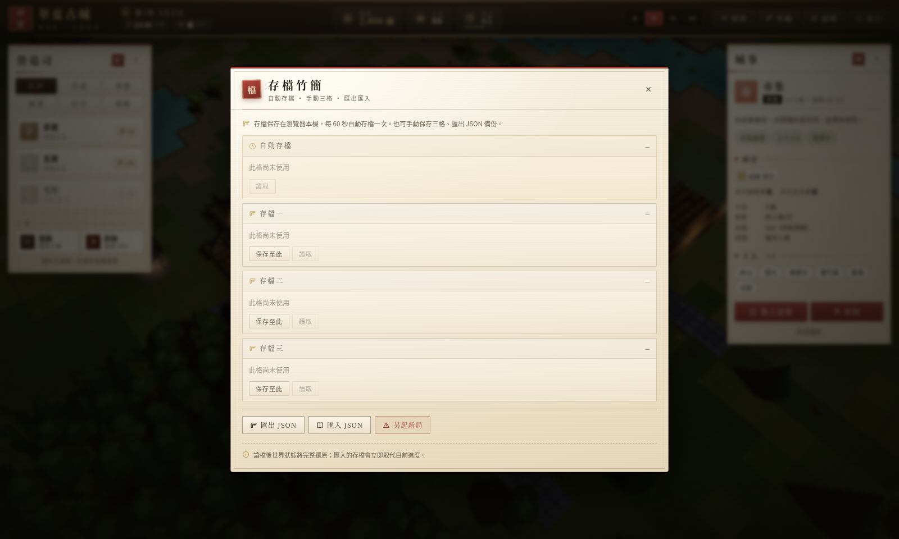
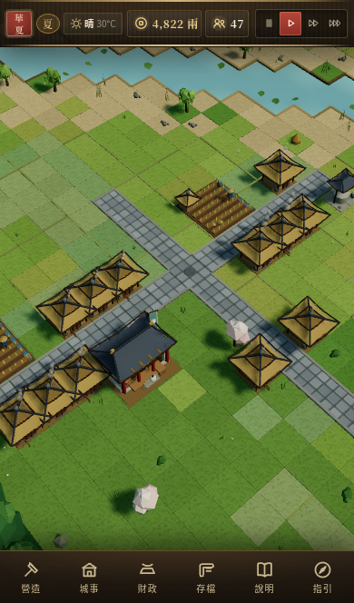
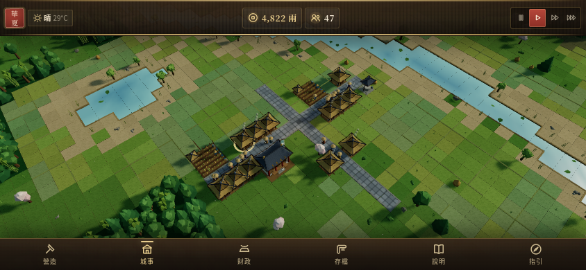

# 華夏古城 · Huaxia City

> 以 **three.js + TypeScript + Vite** 打造的中國古代城市建造模擬遊戲（SimCity 類型）。
> 鋪路、墾田、招商、課稅，看百姓在四季晴雨中作息；每一棟建築都可以走進去。

🌐 **進入遊戲**
- **線上（Cloudflare Workers）**：<https://ancientchinacity.fungkingfai.workers.dev/>
- 本機：`http://127.0.0.1:4173`（生產建置）或 `http://127.0.0.1:5173`（開發伺服器）
- 同一個 Wi-Fi／區網的其他裝置：`http://192.168.68.67:4173`（生產）或 `http://192.168.68.67:5173`（開發）
  - 伺服器已綁定 `0.0.0.0`；若 IP 變了可用 `hostname -I` 查目前位址後替換主機名稱。
  - 若其他裝置仍連不上：確認裝置在同一個網段、路由器沒有開啟 AP/用戶端隔離，或本機防火牆未封鎖 4173／5173 埠。



| 走進建築室內 | 財政月報 |
|---|---|
|  |  |
| **夏夜** | **冬雪** |
|  |  |
| **雨天** | **存檔系統** |
|  |  |

### 手機版介面（自動切換）

手機／平板會自動使用手機版 UI（底部導覽＋底部面板＋觸控手勢），電腦則保持原本的桌面版 UI。

| 手機城市畫面 | 手機營造面板 |
|---|---|
|  |  |
| **手機城事面板** | **手機橫向** |
|  |  |

## 遊戲特色

| 系統 | 內容 |
|---|---|
| 🏯 **城市建設** | 72×72 格地圖、22 種中式建築（茅屋／瓦房／宅院／農田／茶園／伐木場／採石場／鐵礦場／酒坊／織坊／鐵匠鋪／糧倉／貨棧／市集／茶館／客棧／水井／寺廟／學堂／衙門／涼亭／碼頭）、道路網與跨河渡口 |
| 🗺️ **地形** | 蜿蜒河流、湖泊、平原、沃土、林地、丘陵、山地、沙岸；樹木花草、山石、田埂、烏篷船、遠山積雪 |
| 👥 **村民** | 個體模擬：住屋、就業、通勤、購物、休憩；需求（糧食／日用品／文化）、幸福度、移民與人口成長 |
| 🚚 **物流** | 生產 → 本地暫存 → 搬運工／馬車 → 糧倉／貨棧 → 市集貨架 → 民居；碼頭出口貿易、酒坊／鐵匠鋪原料調撥 |
| 💰 **財政** | 人頭稅、田賦、商稅、衙門加成、維護費、服務收入；稅率 0–20%、月度報表、節慶政策、破產警告 |
| 🌅 **時間** | 晝夜循環（子丑寅卯時辰）、春夏秋冬四季、晴／陰／雨／雪；天氣影響農作、交通與民心 |
| 🚪 **可進入建築** | 雙擊或點「進入建築」即可走進室內；22 種建築各有不同內裝（民居床榻、衙門大堂、寺廟佛龕、酒坊酒罈……），顯示居民／工人名單、庫存、本月帳目 |
| 💾 **存檔** | 自動存檔 ＋ 3 個手動存檔格 ＋ JSON 匯出／匯入；重新整理頁面自動接續 |
| 🎨 **介面** | 宣紙墨線、朱印金字、宋式界畫風格；建造面板、城事資訊、財政、存檔、教學、toast、室內面板 |
| 📱 **手機／桌面雙介面** | 自動偵測裝置：手機用底部導覽＋底部面板＋觸控手勢；電腦保留原有桌面版介面。支援直向／橫向、瀏海安全區與手機 GPU 降載 |

## 操作

| 操作 | 說明 |
|---|---|
| 左鍵 | 建造／選取建築 |
| 雙擊建築 | 進入建築室內 |
| 右鍵拖曳 | 旋轉視角；右鍵點擊取消工具 |
| 中鍵拖曳 / Shift＋左鍵 | 平移視角 |
| 滾輪 | 縮放 |
| WASD / 方向鍵 | 平移 |
| Q / E | 旋轉 |
| 空白鍵 | 暫停／繼續 |
| 1 / 2 / 3 / 0 | 倍速 / 暫停 |
| F / H / Esc | 財政 / 說明 / 取消 |

**手機操作**

| 手勢 | 說明 |
|---|---|
| 單指點擊 | 建造／選取建築 |
| 單指拖曳 | 平移視角 |
| 雙指捏合 | 縮放 |
| 雙指旋轉 | 旋轉視角 |
| 依序點擊同一建築兩次 | 進入建築室內（或點「城事 → 進入建築」） |
| 底部導覽列 | 營造 / 城事 / 財政 / 存檔 / 說明 / 指引 |

手機／平板會自動切換介面；亦可用 `?ui=mobile` 或 `?ui=desktop` 強制指定（方便測試）。

**新手五步**：鋪路 → 蓋茅屋（人口解鎖）→ 墾農田（糧食）→ 建市集＋糧倉（物流與供貨）→ 課稅與節慶（民心與財政）。

## 開發

```bash
npm install
npm run dev        # http://127.0.0.1:5173（同時開放區網存取）
npm run build      # tsc 型別檢查 + vite 生產建置
npm run preview    # 預覽生產建置（http://127.0.0.1:4173，也開放區網）
npm test           # vitest 單元／整合測試
npm run shot       # 無頭瀏覽器截圖（需先啟動 dev server）
npm run verify     # 全流程自動驗收（建村、快轉、生產、物流、財政、天氣、室內、存檔）
npm run verify:ui  # 真實滑鼠／鍵盤 UI 互動驗收
npm run verify:mobile  # iPhone 模擬：手機介面、觸控手勢、桌面回歸與手機截圖
```

> 需要支援 WebGL 的瀏覽器（Chrome／Edge／Firefox／Safari 均可）。

## Cloudflare Workers 部署

專案已包含 `wrangler.jsonc`（Workers 靜態資產模式，無需 Worker 程式碼）：

```bash
npm run build
npm run deploy      # = npm run build && wrangler deploy
```

Cloudflare Workers Builds 設定：
- Git repository：`fungkingfai/ancientchinacity`（**main 為 production branch**）
- Build command：`npm run build`
- Deploy command：`npx wrangler deploy`
- 設定檔：`wrangler.jsonc`（`assets.directory = ./dist`、SPA fallback）
- 不需要 `@cloudflare/vite-plugin`；`vite.config.ts` 保持一般 Vite 設定即可。

**部署流程**：commit 並 push 到 `main` → Cloudflare 自動 `npm install` → `npm run build` → `npx wrangler deploy`。
或在本機以 `npm run deploy`（需先 `npx wrangler login` 或設定 `CLOUDFLARE_API_TOKEN`）直接部署。

預覽部署（Preview branches）可在 Cloudflare Worker → Settings → Builds 開啟。

## 專案結構

```
src/
  core/      型別、設定資料表、狀態管理（GameStore）、存檔、開新局、時間格式
  world/     程序化世界生成（地形、河流、渡口）
  sim/       模擬：時間天氣、市民、人口、物流、生產、財政、統計、路徑、擺放
  render/    three.js：城市視圖、地形、道路、建築、市民、環境、室內、建築模型庫
  core/device.ts  裝置偵測（手機／電腦介面自動切換）
  ui/        DOM 介面：頂欄、營造面板、城事面板、財政／存檔／教學、室內面板、toast
  ui/mobile-bar.ts + ui/css/mobile.css  手機版底部導覽與底部面板
  main.ts    組裝 actions、主迴圈、存檔排程
docs/        研究、遊戲設計文件、技術架構、多 Agent 開發報告
tests/       vitest 單元與模擬整合測試
scripts/     截圖與自動驗收工具
```

## 文件

- [遊戲設計文件](docs/GAME_DESIGN.md) — 玩法、數值、物流、財政、UI 規格
- [同類遊戲研究](docs/RESEARCH.md) — 龍之崛起、Pharaoh、Anno、Banished、Manor Lords、Foundation、江南百景圖
- [技術架構與 Agent 分工](docs/ARCHITECTURE.md)
- [多 Agent 開發報告](docs/TEAM_REPORT.md) — 七個 Agent 的分工、交付與整合驗收

## 已知限制

- 建築外觀固定朝向（碼頭依水域轉向），未做 LOD；上千棟建築時可再優化 draw call。
- 地形高低差較大處建築仍以固定基準高度擺放（可能微微埋入／浮空）。
- 市民路徑行走於道路上，未模擬行人穿越農田的捷徑。
- 存檔使用 localStorage，瀏覽器清除網站資料會遺失存檔；建議定期匯出 JSON。

## 授權

MIT
